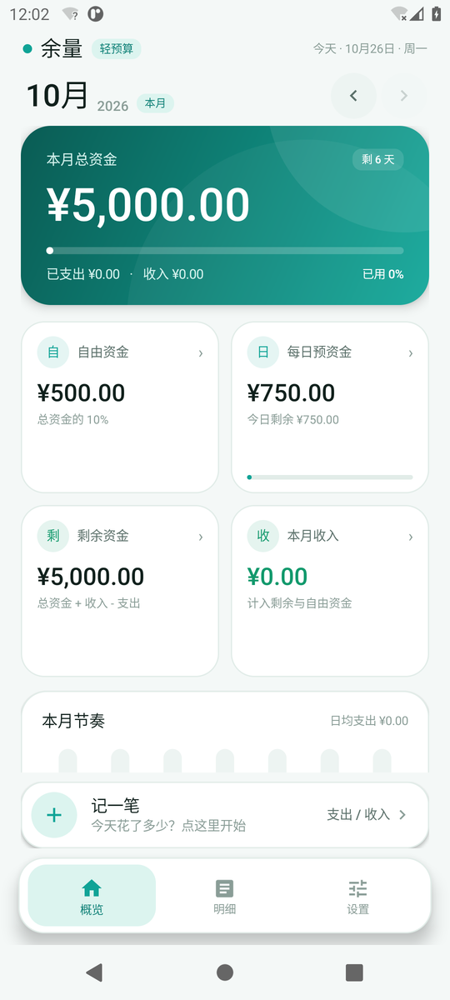
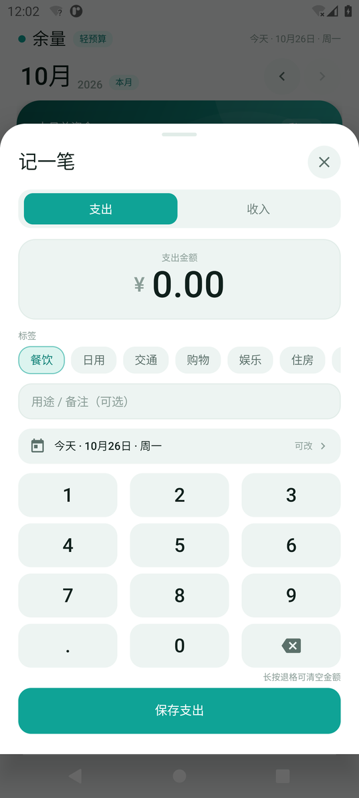
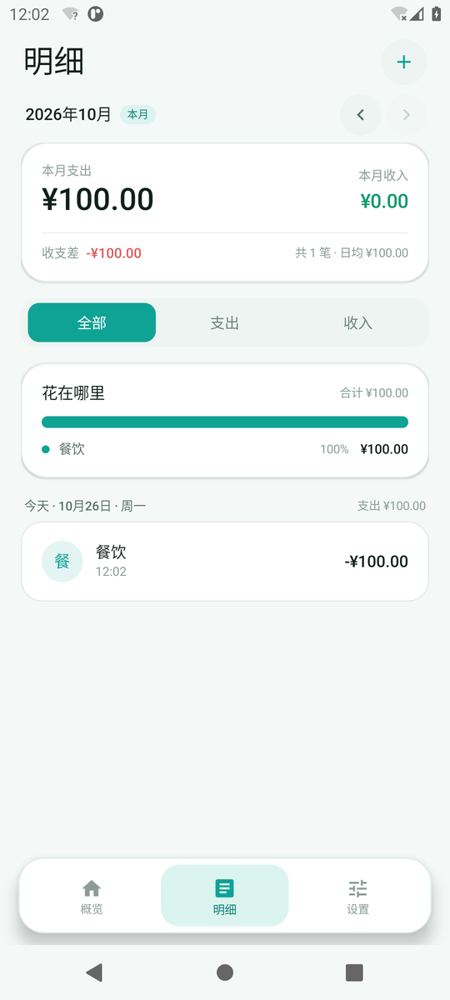
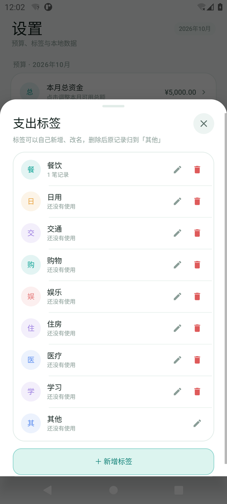
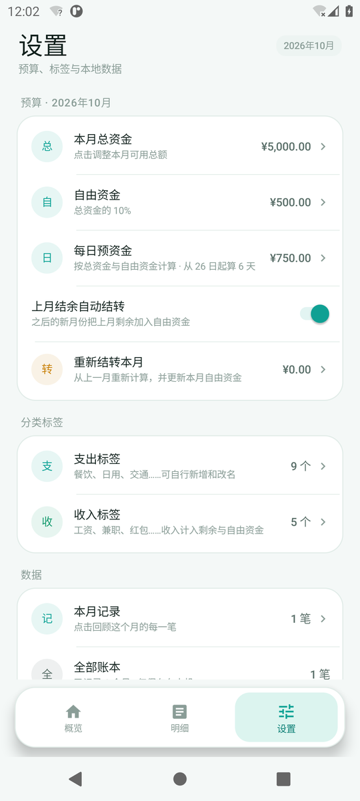
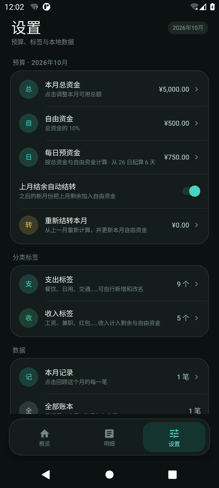

# 余量 · 轻预算

一个离线、无广告、无联网权限的月度预算 + 记账 Android 应用。按照 `要求.txt` 实现，图标来自 `icon.png`。

**安装包：`dist/余量-1.0.0.apk`**（同一个文件也提供了 ASCII 文件名 `dist/yuliang-1.0.0.apk`）

- 最低系统：Android 8.0（API 26）
- 目标系统：Android 15（API 35），适配 Xiaomi HyperOS / MIUI、原生 Android 及主流国产系统
- 屏幕：手机竖屏为主，使用 edge-to-edge、自适应图标、深色模式；没有申请任何权限

| 浅色首页 | 记一笔 |
| --- | --- |
|  |  |

| 明细 | 标签管理 |
| --- | --- |
|  |  |

| 设置 · 浅色 | 设置 · 深色 |
| --- | --- |
|  |  |

## 功能

### 1. 首页

- **本月总资金**放在最显眼的渐变卡片中，显示已支出、收入、使用进度、剩余天数。
- 四张指标卡：
  - **自由资金**：默认总资金的 10%，可调比例；包含上月结转和本月收入。
  - **每日预资金**：`(总资金 - 自由资金) ÷ 生效天数`；月中设置时按剩余天数分摊。
  - **剩余资金**：`总资金 + 上月结转 + 收入 - 支出`。
  - **本月收入**：同时计入剩余资金和自由资金。
- 本月节奏：近 7 天支出柱状图，点击卡片查看完整规则。
- 最近记录：最近 3 笔，可跳转全部明细。
- 底部大输入框：点击进入“记一笔”底部面板。

### 2. 记一笔

- 支出 / 收入切换。
- 大金额显示 + 自定义数字键盘，支持小数、长按退格清空。
- 标签横向选择：餐饮、日用、交通、购物、娱乐、住房、医疗、学习、其他；收入有工资、兼职、红包、理财、其他。
- 可新增标签；在“设置 → 分类标签”里可改名、删除，删除后原记录自动归入“其他”。
- 用途 / 备注、日期（可回选本月内日期，不能选未来）。
- 点击已有记录可编辑或删除。

### 3. 明细

- 本月支出、收入、收支差、日均、笔数汇总。
- 按日期分组，展示每笔时间、标签、备注和金额。
- 全部 / 支出 / 收入筛选。
- 分类占比条 + 分类金额明细。

### 4. 设置

- 预算调整：总资金、自由资金比例、每日预支出反推，修改后按本月流水重新计算。
- 上月结余自动结转开关；可“重新结转本月”从上一月重新取数。
- 支出 / 收入标签管理。
- 本月记录、全部账本、清空本月记录。
- 使用说明、外观、版本信息。

### 5. 外观

- 浅色 / 深色跟随系统自动切换（Activity 随 `uiMode` 重建）。
- 柔和薄荷绿配色；数字使用系统无衬线字体；极简卡片、圆角、按压回弹、触感反馈、底部面板滑入动画。
- 禁止系统强制深色覆盖（`forceDarkAllowed=false`），保证配色和文字对比度。

## 预算规则

这些规则由纯 Java 的 `BudgetEngine` 统一计算，UI 只负责展示：

1. **总资金**由用户每月设定。
2. **自由资金**默认 = 总资金 × 10%，比例可调；也可直接设定每日预支出。
3. **每日预资金** = `(总资金 - 自由资金) ÷ 生效天数`。
   - 整月设置时，生效天数就是本月天数；
   - 月中才设置时，从设置当天算到月底，避免把没有经历过的日子补记成“每日结余”。
4. **每日结算**：
   - 当天先用每日预资金；
   - 当天超支的部分从自由资金扣；
   - 当天没用完的每日预资金，结束当天后转入自由资金；
   - 今天的未用额度要等到明天才会进入自由资金。
5. **两边都空了**：自由资金与当日预资金都耗尽时，从剩余资金扣，并把剩余资金重新平均到本月剩下的天数；首页会出现“已按剩余资金重新分配”的提示。
6. **收入**：同时增加剩余资金和自由资金。
7. **上月结转**：新月份把上一月的正剩余结转到自由资金；这个结转值是快照，之后修改上一月数据，可在设置里点“重新结转本月”刷新。
8. **每日预支出优先于比例**：设定后 `自由资金 = 总资金 - 生效天数 × 每日预支出`；结果小于 0 时不允许保存。
9. **剩余资金** = `总资金 + 上月结转 + 收入 - 支出`；自由资金是剩余资金中可灵活支配的一部分。

> 说明：如果月中才第一次设置预算，应用不会把设置前已经过去的日子按“没花完”补进自由资金，而是从设置当天开始计算；设置前已经记过的流水仍会扣减剩余资金。

## 安装

1. 把 `dist/余量-1.0.0.apk` 传到手机。
2. 在文件管理器中点击安装。HyperOS 首次安装需要允许“安装未知应用”。
3. 应用不申请联网、存储、定位等任何权限；数据只保存在应用私有目录（SharedPreferences），并交给 Android Auto Backup 做系统备份。
4. 卸载应用会删除本地账本，请勿在未备份时直接卸载。

签名：v2 + v3（Android 8+ 均可安装）。构建使用项目内 `app/keystore/yuliang-release.jks`，别名 `yuliang`，密码 `Yuliang2026!`。这个密钥仅用于本应用，请保留它以便后续覆盖安装；如果要上架应用商店，建议换成你自己的私钥。

## 从源码构建

不需要 Gradle / AndroidX。`build.ps1` 直接调用 aapt2、javac、d8、zipalign、apksigner，并生成可安装 APK。

### 环境

- Windows + PowerShell 5.1 或 PowerShell 7
- **JDK 17**（需要包含 `javac`、`keytool`）
- Android SDK：**platform 35** + **build-tools 35.x**
  - 如果未指定 SDK，脚本会自动下载最小 SDK 到项目下的 `.sdk/`（约 120 MB）
- 首次构建需要网络；后续可离线

### 命令

```powershell
# 使用已有 SDK
powershell -ExecutionPolicy Bypass -File .\build.ps1 `
  -Jdk "C:\Program Files\Java\jdk-17" `
  -Sdk "C:\Users\你的用户名\AppData\Local\Android\Sdk"

# 不指定 -Sdk 时，会自动把 SDK 下载到 .sdk/
powershell -ExecutionPolicy Bypass -File .\build.ps1 -Jdk "C:\Program Files\Java\jdk-17"

# 跳过 JVM 预算规则测试
powershell -ExecutionPolicy Bypass -File .\build.ps1 -Jdk "..." -Sdk "..." -SkipTests
```

输出：

- `dist/余量-<version>.apk`
- `dist/yuliang-<version>.apk`
- `dist/SHA256.txt`

当前成品 `dist/余量-1.0.0.apk` 的 SHA-256：

```text
E717FC1A1F3EA27C781E9E4849AD8B5FD6F463521D75127C434E2DA3B6B601EE
```

构建脚本做了两件兼容性处理：

1. 所有 aapt2 参数使用相对路径，避免 Windows 中文路径下 aapt2 的路径解析问题；
2. 用 `tools/RepackApk.java` 重新打包 APK，强制 `resources.arsc` 以 **STORED** 方式写入并 4 字节对齐，否则 Android 11+ 会拒绝安装。

### 验证

```powershell
# 签名验证
java -jar "%ANDROID_HOME%\build-tools\35.0.0\lib\apksigner.jar" verify --verbose dist\余量-1.0.0.apk

# 预算规则单元测试（31 项）
javac -cp app\build\classes -d tools\test-classes tools\TestEngine.java
java -cp "app\build\classes;tools\test-classes" TestEngine
```

## 项目结构

```
financial/
├─ app/
│  ├─ src/main/AndroidManifest.xml
│  ├─ src/main/java/com/yuliang/ledger/
│  │  ├─ MainActivity.java          # 单 Activity + 三个 Tab
│  │  ├─ data/
│  │  │  ├─ Models.java
│  │  │  ├─ LedgerStore.java        # SharedPreferences + JSON 本地存储
│  │  │  └─ BudgetEngine.java       # 纯 Java 预算规则，可 JVM 单测
│  │  └─ ui/
│  │     ├─ HomeScreen.java
│  │     ├─ RecordsScreen.java
│  │     ├─ SettingsScreen.java
│  │     ├─ AddSheet.java
│  │     ├─ BudgetSheet.java
│  │     ├─ CategorySheet.java
│  │     ├─ MonthPickerSheet.java
│  │     ├─ InfoSheet.java
│  │     ├─ SheetHost.java          # 自绘底部面板（无 AndroidX）
│  │     ├─ AppTheme.java / Ui.java
│  │     └─ view/                   # 渐变卡、进度线、柱状图、分段控件
│  ├─ src/main/res/                 # 自适应图标、深色配色、splash
│  └─ keystore/yuliang-release.jks
├─ tools/
│  ├─ make_icons.py                 # 从 icon.png 生成各密度图标
│  ├─ RepackApk.java                # 修复 resources.arsc 压缩/对齐
│  └─ TestEngine.java               # 31 项预算规则测试
├─ docs/screenshots/
├─ dist/                            # 成品 APK
├─ build.ps1
├─ icon.png                         # 原始图标
├─ 要求.txt
└─ README.md
```

## 已验证

- **Android 11（API 30）模拟器**：安装、启动、首启设置预算、支出/收入记账、编辑、删除、明细筛选、分类占比、标签新增、月份切换、深色/浅色切换、日期选择器、底部面板。
- **JVM 预算引擎测试 31 项全部通过**，覆盖：比例分配、每日结余、自由资金兜底、收入、上月结转、每日预支出、剩余资金再分配、月中开始预算。
- **APK 签名 v2/v3 通过**，`resources.arsc`/`classes.dex` 均以 STORED 写入并通过 `zipalign -c 4`。
- HyperOS 适配使用系统标准能力（edge-to-edge、自适应图标、深色模式、无强制深色）；建议在 HyperOS 真机上再确认一次状态栏、字体缩放和系统深色切换的视觉效果。

## 数据与隐私

- 没有 `INTERNET` 权限，不会上传任何账目。
- 数据保存在 `SharedPreferences`，仅本机可见；Android 系统备份可能随账号备份。
- 没有广告、统计 SDK、第三方依赖。
